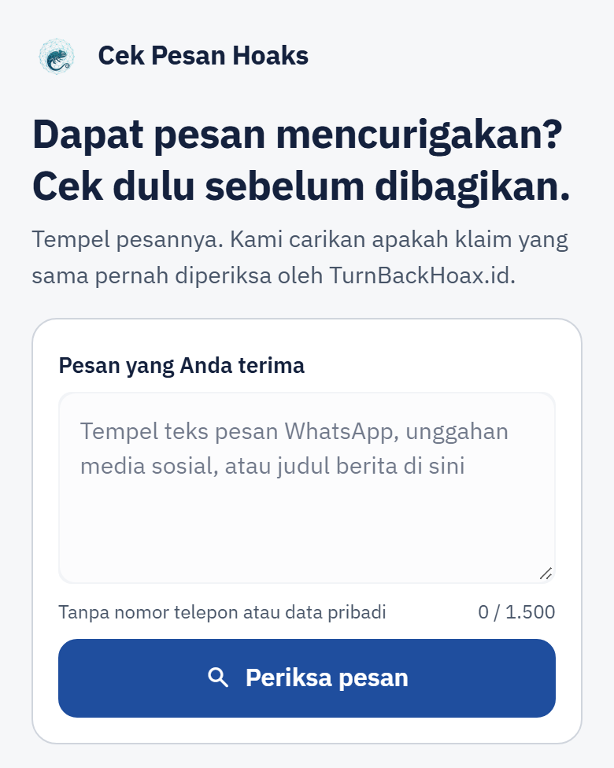
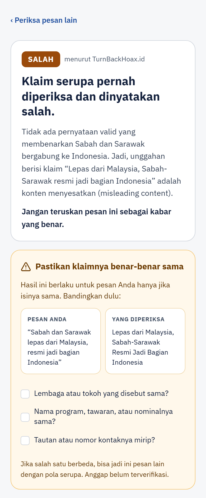

# Cek Pesan Hoaks: RAG Verifikasi Klaim

Banyak pesan hoaks yang beredar sebenarnya sudah pernah diperiksa pemeriksa fakta. Masalahnya, artikel
pemeriksaannya susah dicari karena kata-kata di pesan sering berbeda dengan judul artikel. Di proyek ini,
pengguna menempel pesan, lalu sistem mencari tiga artikel TurnBackHoax.id yang isinya paling mirip (embedding
BGE-M3 dan ChromaDB). Setelah itu Gemini memutuskan apakah salah satu artikel itu membahas klaim yang sama.
Kalau ya, label, kesimpulan, dan tautan rujukan ditampilkan persis seperti di artikel. Kalau tidak,
jawabannya "belum ditemukan". Sistem ini tidak menilai sendiri benar atau salahnya klaim baru.

## Hasil evaluasi singkat

Sistem diuji pada set eksternal 91 klaim nyata dari Liputan6 Cek Fakta, dengan indeks 1.532 artikel yang
dibekukan selama pengujian. Batas lulus ditentukan sebelum pengujian dimulai. Setiap klaim dijalankan tiga
kali, dan yang dihitung adalah keputusan yang paling sering muncul.

| Yang diukur | Hasil (interval Wilson 95%) | Batas yang ditentukan sebelumnya | Hasil akhir |
| --- | --- | --- | --- |
| Klaim yang ada di arsip: artikel yang benar ditemukan | 36/46 = 78,3% [64,4%; 87,7%] | memadai kalau batas bawah >= 60% | **memadai** |
| Klaim yang tidak ada di arsip: tetap dicocokkan dengan artikel lain (kecocokan palsu) | 10/45 = 22,2% [12,5%; 36,3%] | gugur kalau batas bawah > 10% | **gugur** |

**Gugur** berarti kecocokan palsu terbukti lebih sering dari batas 10%, karena seluruh intervalnya ada di
atas 10%. Halaman Tentang di demo menyebut hasil yang sama dengan "Belum lulus" supaya mudah dipahami
pengguna umum; keduanya merujuk ke hal yang sama.

Jadi, kalau klaimnya ada di arsip, sistem biasanya menemukannya. Kalau tidak ada, sekitar satu dari lima
klaim tetap dicocokkan dengan artikel yang keliru, paling sering pada penipuan yang polanya sama tetapi
lembaga atau programnya berbeda. Karena itu setiap hasil "ditemukan" di demo diberi kotak untuk mengecek
sendiri. Angka ini berlaku untuk indeks 1.532 artikel, bukan otomatis untuk indeks demo yang terus
bertambah. Sumber angka: `testset/eksternal_hasil_per_butir.json` dan `testset/eksternal_butir.json`; batas
lulus ada di [`docs/rancangan/rancangan_evaluasi_eksternal.md`](docs/rancangan/rancangan_evaluasi_eksternal.md)
bagian 6. Penjelasan lengkapnya ada di [Hasil Evaluasi](#hasil-evaluasi).

<table>
  <tr>
    <td valign="top"></td>
    <td valign="top"></td>
  </tr>
  <tr>
    <td>Beranda</td>
    <td>Hasil "ditemukan"</td>
  </tr>
</table>

Tangkapan layar lengkap (390 dan 1280 px, termasuk halaman Tentang dan hasil "belum ditemukan") ada di
[`docs/tampilan/`](docs/tampilan/).

## Menjalankan demo dengan Docker

Indeks vektor dan model embedding tidak disertakan di repositori, karena indeks berisi teks artikel dari pihak
lain. Jadi siapkan dulu venv, indeks, dan model di komputer sendiri ([Cara Menjalankan](#cara-menjalankan)).
Setelah itu, untuk pertama kali:

```powershell
if (-not (Test-Path .env)) { Copy-Item .env.example .env }   # tidak menimpa .env yang sudah ada
New-Item -ItemType Directory -Force data\container\kuota, data\container\logs
Copy-Item -Recurse data\chroma data\container\chroma   # salinan indeks khusus container
docker compose up --build   # buka http://127.0.0.1:8501 setelah container berstatus healthy
```

Pastikan `GEMINI_API_KEY` di `.env` sudah terisi (kuncinya bisa dibuat gratis di Google AI Studio). Kebutuhan
memori, volume, dan cara memperbarui salinan indeks ada di [`docs/operasional.md`](docs/operasional.md#docker).

Ini proyek portofolio pribadi dan bukan layanan resmi Mafindo. Data artikel berasal dari
[TurnBackHoax.id](https://turnbackhoax.id) (Mafindo) dan tidak disertakan di repositori ini. Kodenya
berlisensi [MIT](LICENSE). Status: Versi 1 selesai dan sudah diukur; Versi 2 belum dimulai.

---

## Daftar Isi

- [Arsitektur](#arsitektur)
- [Keputusan Desain Utama](#keputusan-desain-utama)
- [Hasil Evaluasi](#hasil-evaluasi)
- [Keterbatasan](#keterbatasan)
- [Rencana Versi 2](#rencana-versi-2)
- [Cara Menjalankan](#cara-menjalankan)
- [Posisi dalam Literatur](#posisi-dalam-literatur)
- [Struktur Repositori](#struktur-repositori)
- [Sumber Data](#sumber-data)
- [Lisensi](#lisensi)
- [Rujukan](#rujukan)

Detail operasional (ingest antrean, pemulihan, perekaman, pembaruan berkala, arsip Versi 1, Docker):
[`docs/operasional.md`](docs/operasional.md).

---

## Arsitektur

### Jalur kueri (setiap pesan)

```
Pesan pengguna (maks. 1.500 karakter)
      ↓
Retrieval   bge-m3 → ChromaDB; skor artikel = chunk terbaiknya; 3 artikel teratas    [kode]
      ↓
Gemini      gemini-3.5-flash-lite memilih satu dari 3 artikel, atau menolak          [LLM]
      ↓
Validasi    id harus salah satu dari 3 kandidat; URL dari LLM dibuang                 [kode]
      ↓
Tampilan    label, Kesimpulan, dan rujukan apa adanya dari artikel,                   [kode]
            ditambah kotak "Pastikan klaimnya benar-benar sama"
```

Hanya satu tahap yang memakai LLM, dan tugasnya sempit: menilai apakah pesan pengguna memuat klaim yang sama
dengan salah satu dari tiga artikel kandidat. Label diambil dari metadata artikel, Kesimpulan TurnBackHoax
ditampilkan apa adanya (bukan parafrase LLM), dan tautan hanya berasal dari seksi Referensi yang sudah
disaring. Demo berjalan sebagai satu proses Streamlit di atas pipeline yang sama dengan yang dievaluasi.

### Jalur pengindeksan (luring)

```
TurnBackHoax.id → scraping & parsing → chunking per seksi → embedding bge-m3 → ChromaDB
                  (rujukan dipisah     (Narasi, Penjelasan,
                   dari sumber hoaks)   Kesimpulan)
```

Pembaruan berkala (Task Scheduler, setiap hari) hanya mengambil artikel baru ke antrean. Penggabungan dan
ingest dijalankan manual setelah pemeriksaan kualitas. Indeks demo saat ini memuat 1.611 artikel / 4.830
chunk (daftar artikel: `archive/v1/article_ids.json` dan `manifests/expansion_article_ids.json`; jumlah chunk:
`testset/retriever_exactness_1611.json`).

---

## Keputusan Desain Utama

**Chunking mengikuti struktur dokumen, bukan jumlah karakter.**
Artikel TurnBackHoax memiliki seksi baku (Narasi, Penjelasan, Kesimpulan,
Referensi). Setiap seksi menjadi satu chunk, sehingga peran tiap bagian tetap
terpisah: klaim yang beredar, proses penelusuran, dan faktanya.

**Tautan sumber hoaks dipisahkan dari rujukan sahih.**
Seksi Referensi pada artikel nyata ternyata memuat campuran keduanya — tautan
ke unggahan hoaks aslinya berdampingan dengan rujukan media kredibel. Keduanya
disimpan pada medan terpisah; hanya rujukan sahih yang ditampilkan ke pengguna.

**LLM tidak pernah menghasilkan URL.**
Tautan diambil dari metadata dokumen hasil retrieval. Model bahasa yang diminta
menuliskan URL dari ingatannya cenderung berhalusinasi.

**Status verifikasi berasal dari metadata, bukan dari LLM.**
LLM hanya boleh memilih `article_id` dari tiga kandidat; id di luar kandidat
ditolak dan diperlakukan sebagai "tidak ditemukan".

**"Belum ditemukan" adalah jawaban yang sah.**
Bila tidak ada klaim yang sepadan, sistem menyatakannya secara eksplisit alih-alih
memaksakan kecocokan.

Keputusan arsitektur tercatat sebagai ADR (konteks, keputusan, alternatif yang ditolak, konsekuensi) di
[`docs/adr/`](docs/adr/README.md):

| Keputusan | ADR |
| --- | --- |
| Streamlit hanya sebagai lapisan tampilan; logika di modul tanpa Streamlit yang diuji offline | [0001](docs/adr/0001-streamlit-untuk-demo.md) |
| Generator (termasuk prompt), retriever, dan chunker dikunci dengan hash agar angka evaluasi tetap sah untuk kode yang berjalan | [0002](docs/adr/0002-berkas-terkunci.md) |
| ChromaDB lokal; kesetaraan indeks dibuktikan dari isinya, bukan byte berkas | [0003](docs/adr/0003-chromadb-lokal.md) |
| Gemini tier gratis lewat antarmuka penyedia yang bisa diganti; pengaman dipasang di kode, bukan di prompt | [0004](docs/adr/0004-gemini-tier-gratis.md) |
| Docker (Python 3.13) untuk lingkungan yang dapat direproduksi; venv Python 3.11 tetap lingkungan evaluasi | [0005](docs/adr/0005-docker-volume-python-313.md) |
| Catatan aktivitas tanpa isi pesan (sudah diputuskan, belum dibangun) | [0006](docs/adr/0006-catatan-aktivitas-tanpa-isi-pesan.md) |
| Satu proses, bukan microservice | [0007](docs/adr/0007-tanpa-microservice.md) |

---

## Hasil Evaluasi

Ada dua evaluasi yang dijalankan dengan generator, masing-masing pada indeks yang berbeda: **set uji v1**
pada indeks arsip 150 artikel (baseline Versi 1), dan **evaluasi eksternal** pada indeks produksi 1.532
artikel, yaitu indeks yang dipakai demo saat itu (kini demo memakai indeks yang lebih besar). Pada keduanya set uji dibekukan dan ambang ditetapkan sebelum
evaluasi dijalankan, prompt, generator, dan retriever dikunci dengan hash, dan setiap butir dijalankan
**tiga kali** dengan keputusan modus sebagai metrik utama. Generatornya `gemini-3.5-flash-lite` (thinking
medium). Semua proporsi disertai interval Wilson 95%.

### Ringkasan berdampingan

| Evaluasi | Indeks | Butir | Hasil |
| --- | --- | --- | --- |
| Set uji v1 (Versi 1, baseline) | `archive/v1`, 150 artikel | 50 non-batas | Akurasi **48/50** [86,5%; 98,9%]; Recall@3 36/40 |
| Set uji v1, uji kemunduran | produksi, 1.532 artikel | 44 non-batas (6 butir dikeluarkan karena labelnya tidak berlaku lagi) | Benar **37/44** = 84,1% [70,6%; 92,1%] vs 42/44 di arsip; **kemunduran bersih 5 -> MUNDUR** (ambang >= 3) |
| Set eksternal Liputan6, positif | produksi, 1.532 artikel | 46 | Ketepatan **36/46 = 78,3%** [64,4%; 87,7%] -> **memadai** (ambang: batas bawah >= 60%) |
| Set eksternal Liputan6, negatif | produksi, 1.532 artikel | 45 | Kecocokan palsu **10/45 = 22,2%** [12,5%; 36,3%] -> **gugur** (ambang: gugur bila batas bawah > 10%) |
| Set eksternal, retrieval | produksi, 1.532 artikel | 46 positif | Recall@3 bersyarat **41/46 = 89,1%** [77,0%; 95,3%] |

Angka produksi berlaku untuk indeks 1.532 artikel / 4.593 chunk yang dibekukan selama evaluasi, dengan
sidik jari tercatat (embedding `9851a6dc`, teks dan metadata `6283f0f6`;
[`docs/rancangan/rancangan_evaluasi_eksternal.md`](docs/rancangan/rancangan_evaluasi_eksternal.md) bagian 5). Indeks demo bisa
bertambah setelah pembaruan berkala, jadi angka ini tidak otomatis berlaku untuk indeks yang lebih besar.

Angka di tabel ini adalah angka resmi. Pemeriksaan label sesudahnya (adjudikasi dan verifikasi, di bawah)
dilaporkan sebagai sensitivitas dan tidak menggantikannya; aturan pemakaiannya ditetapkan sebelum berkasnya
diisi.

**Cara membaca:**
- Angka Versi 1 dan angka produksi **tidak sebanding langsung**: indeksnya berbeda (150 vs 1.532 artikel),
  jadi selisihnya mencampur efek data dan bukan uji arsitektur.
- **Recall@3 bersyarat** hanya dihitung pada pasangan yang memang terjangkau pencarian judul saat set
  disusun. Ia batas atas; Recall@3 atas seluruh klaim yang ada di TurnBackHoax tidak dapat diukur dari
  set ini. Sebagai pembanding, bila yang dicari judul artikel Liputan6 (bukan kutipan pesan), artikel yang
  benar masuk tiga besar pada 44/46.
- **"Lulus" pada kecocokan palsu berarti tidak terbukti buruk, bukan terbukti aman.** Di sini hasilnya
  gugur: interval seluruhnya di atas 10%.
- Hasil per butir evaluasi eksternal disegel sampai keandalan label dan label final di-commit; segel dibuka
  2026-10-20 (`testset/eksternal_hasil_per_butir.json`).

### Baseline Versi 1 (set uji v1, `archive/v1`, 150 artikel)

Set uji 54 butir dibekukan sebelum evaluasi (tag `testset-v1`), dengan ambang hipotesis dipra-registrasi
sebelum data dibuat.

| Tipe | Jumlah | Keterangan |
| --- | --- | --- |
| Positif | 20 | Klaim yang ada di basis data |
| Negatif sulit | 20 | Bertetangga topik, bukan klaim yang sama (7 pola sama entitas beda, 7 entitas sama klaim beda, 6 angka/waktu beda) |
| Negatif mudah | 10 | Topik jauh dari basis data |
| Batas | 4 | Kasus ambigu, dilaporkan terpisah, tidak masuk metrik utama |

| Metrik (set uji v1, `archive/v1`) | Hasil | Wilson 95% |
| --- | --- | --- |
| Akurasi, 50 butir non-batas | 48/50 | 0,865 – 0,989 |
| Akurasi, 4 butir batas (terpisah) | 3/4 | 0,301 – 0,954 |
| Kecocokan palsu (negatif dijawab ditemukan) | 1/30 | — |
| Penolakan palsu (positif dijawab belum ditemukan) | 1/20 | — |
| Artikel salah dipilih | 0/20 | — |
| Recall@3 retrieval (non-batas) | 36/40 | — |
| Pelanggaran format | 0/162 panggilan | — |
| URL di luar metadata | 0/162 panggilan | — |

| Hipotesis | Status |
| --- | --- |
| **H1** — LLM yang membaca Narasi dapat membedakan klaim identik dari klaim yang sekadar bertetangga topik | Terdukung: 1/20 kecocokan palsu pada basis penuh, **1/17 pada basis benar-benar teruji** (ambang ≤1 pada keduanya) |
| **H3** — Model kelas Flash Lite cukup untuk tugas ini | Terdukung pada sampel ini (2/50 kesalahan, 0 pelanggaran format) |

**Dua mode kegagalan yang terpisah.** Empat kegagalan retrieval semuanya pada butir negatif, sehingga pada
3 dari 7 butir "pola sama entitas beda" generator tidak pernah benar-benar diuji (dasar angka 1/17 di atas).
Sebaliknya, pada semua kesalahan dan keputusan tidak bulat generator, artikel yang benar sudah ada di top-3.

**Caveat yang wajib dibaca bersama angka ini:**
1. **Ketergantungan antar-butir.** 44% butir berbagi artikel jangkar (satu artikel dipakai hingga 4
   butir), sehingga interval Wilson yang menganggap butir saling bebas bersifat terlalu percaya diri.
2. **Pasangan minimal sebagian hasil konstruksi.** Pada subtipe "angka atau waktu beda", seluruh butir
   sengaja diarahkan ke artikel yang sudah punya butir positif, sehingga angka pasangannya bukan hasil
   pengamatan.
3. **Confound sumber.** Subtipe "angka atau waktu beda" 100% buatan model; negatif mudah 0% buatan model.
   Pada kedua sel itu, efek sumber dan tipe butir tidak dapat dipisahkan.
4. **Ukuran sampel.** 50 butir non-batas hanya mampu mendeteksi kegagalan yang jelas; batas bawah Wilson
   86,5% tidak mendukung klaim bahwa akurasi pada set ini di atas 95%.

**Riwayat retrieval saat indeks diperluas** (tanpa LLM; Recall@k butir positif set uji v1, dari 20):

| Indeks | @1 | @3 | @5 | @10 | @20 |
| --- | --- | --- | --- | --- | --- |
| Arsip, 150 artikel | 19/20 | 20/20 | 20/20 | 20/20 | 20/20 |
| Produksi, 922 artikel (2026-09-27) | 18/20 | 20/20 | 20/20 | 20/20 | 20/20 |
| Produksi, 1.532 artikel (2026-10-03) | 18/20 | 20/20 | 20/20 | 20/20 | 20/20 |

Label negatif set uji v1 tidak otomatis berlaku pada indeks yang lebih besar: kini **sembilan** butir
negatif menemukan klaim yang sama di basis data 1.532 artikel (enam tercatat saat perluasan, tiga lagi
diverifikasi setelah evaluasi; lihat di bawah). Karena itu set uji v1 tetap sah sebagai baseline hanya pada
`archive/v1/`. Rincian: `testset/v1_analysis_report.txt`, `testset/v1_perbandingan_indeks_1532.json`,
`testset/v1_temuan_untuk_v2.md`.

### Set evaluasi eksternal

91 klaim nyata dari artikel cek fakta Liputan6 (dari 99; 8 kutipan yang hanya berisi tautan atau salam
dikeluarkan dengan aturan yang ditetapkan sebelum hasil dilihat). Kueri adalah kutipan pesan apa adanya,
seperti yang akan ditempel pengguna. **Positif** = id artikel TurnBackHoax yang memuat klaim yang sama,
**negatif** = tidak ada yang cocok di daftar 5-8 kandidat yang diperiksa. Teks pesan dan artikel Liputan6 tidak diterbitkan di repositori ini; yang
di-commit hanya id, label, dan keputusan per butir. Rancangan lengkap, ambang, dan hasil:
[`docs/rancangan/rancangan_evaluasi_eksternal.md`](docs/rancangan/rancangan_evaluasi_eksternal.md).

**Asal-usul label.** Semua label diputuskan pemilik proyek. Butir 1-5 putaran pertama dibahas bersama
asisten AI sebagai contoh cara mengisi. Sesudah putaran pertama, asisten AI memeriksa berkas terisi dan
menunjukkan aturan yang diterapkan tidak konsisten, tanpa mengubah label. Butir lain putaran pertama,
seluruh putaran kedua (asisten AI hanya membantu teknis berkas), sesi buta, adjudikasi, dan verifikasi
dikerjakan tanpa bantuan AI.

### Keandalan label

Hanya ada satu anotator, jadi yang diukur adalah konsistensi dalam-anotator, bukan kesepakatan
antar-anotator.

- **Uji ulang buta 30 butir acak** (jeda 7 hari, urutan diacak, label lama disembunyikan): kappa biner
  **0,634** [0,308; 0,911] (bootstrap 10.000 ulangan), kappa id persis 0,707 [0,416; 0,921]; 25 dari 30
  sama. Lima yang berubah semuanya soal ada/tidaknya pasangan, tidak ada yang berpindah ke artikel lain.
  Menurut ambang yang dikunci (0,60-0,79), setiap metrik juga dihitung dengan kelima butir itu dibalik ke
  dua arah; kategorinya tidak berubah.
- **Audit jejak identik** (tanpa LLM dan tanpa embedding) mencocokkan dua sinyal antara pesan dan setiap
  kandidat: (a) domain tautan hoaks yang sama, setelah pemendek URL, domain media sosial dan arsip, serta
  sumber tepercaya disaring; dan (b) rangkaian minimal 8 kata identik antara pesan dan Narasi artikel. 7
  butir negatif berjejak ditinjau ulang secara buta, dicampur dengan butir uji ulang. **4 dari 7 berubah
  menjadi cocok**, keempatnya ke artikel yang ditunjuk jejak itu. Label final memakai hasil ini, sehingga
  set menjadi 46 positif dan 45 negatif. Dengan label awal (42/49) kecocokan palsu justru lebih tinggi
  (14/49).

### Adjudikasi buta (sensitivitas)

Setelah segel dibuka, ke-20 butir yang keputusan sistemnya berbeda dari label ditinjau ulang oleh
pemilik proyek: dua pilihan per butir dalam urutan acak, tanpa keterangan mana pilihan sistem.

| Jenis | Butir | Ternyata kesalahan label | Tetap kesalahan sistem |
| --- | --- | --- | --- |
| Kecocokan palsu | 10 | 7 (2 di antaranya ditandai ragu) | 3 |
| Penolakan palsu | 9 | 3 | 6 |
| Artikel salah | 1 | 1 | 0 |

Angka resmi lebih dulu, lalu angka bila label diganti dengan hasil adjudikasi:

| | Positif benar | Kecocokan palsu |
| --- | --- | --- |
| **Label final (angka resmi)** | 36/46 = 78,3% [64,4; 87,7], memadai | 10/45 = 22,2% [12,5; 36,3], gugur |
| Batas yang menguntungkan sistem: adjudikasi, butir ragu tetap berlabel lama | 42/48 = 87,5% [75,3; 94,1], memadai | 5/43 = 11,6% [5,1; 24,5], tidak konklusif |
| Batas yang menguntungkan sistem: adjudikasi, butir ragu ikut adjudikasi | 44/50 = 88,0% [76,2; 94,4], memadai | 3/41 = 7,3% [2,5; 19,4], lulus |

- **Ini batas yang menguntungkan sistem, bukan perkiraan yang lebih akurat.** Hanya butir yang tidak
  sepakat yang ditinjau, jadi adjudikasi hanya bisa menggeser hasil ke arah sistem; kesalahan label pada
  butir yang sepakat tidak dicari. Nilai kecocokan palsu sebenarnya kemungkinan besar berada di antara batas
  ini dan angka resmi, tetapi tidak dijamin: kesalahan label pada butir yang sepakat tidak diperiksa, dan
  sebagian kesalahan semacam itu (misalnya butir berlabel positif yang sebenarnya negatif) justru akan
  menaikkan kecocokan palsu di atas angka resmi. Selain itu penilai yang diperlihatkan dua opsi bisa
  cenderung menerima opsi yang tampak masuk akal, sehingga adjudikasi sendiri berpotensi bias ke arah
  sistem.
- Kategori terburuk pada batas ini: positif **memadai**, kecocokan palsu **tidak konklusif**. Bahkan di
  batas ini kecocokan palsu tidak lulus dengan kokoh: "lulus" hanya tercapai kalau kedua butir ragu
  dihitung ke arah sistem, dengan batas atas 19,4%, tepat di bawah patokan 20%.
- Satu kecocokan palsu mengarah ke artikel di luar daftar kandidat yang dulu diperiksa. Adjudikasi
  menyatakannya bukan klaim yang sama (tokohnya berbeda), jadi itu tetap kesalahan sistem.
- Temuan yang lebih penting dari angkanya: **pada butir yang sulit, label sendiri tidak stabil** (lihat
  [Keterbatasan](#keterbatasan)).

### Verifikasi testset-v1 (sensitivitas)

Tiga butir negatif set uji v1 dijawab "ditemukan" pada indeks 1.532 karena ada artikel baru yang
dicocokkan sistem. Pemilik proyek membaca ketiga pasangan itu sendiri: **ketiganya memuat klaim yang
sama**. Jadi label negatifnya tidak berlaku lagi pada indeks besar, dan ketiga butir itu bukan kesalahan
sistem.

- Angka resmi tetap **kemunduran bersih 5/44, MUNDUR**. Dengan ketiga butir dikeluarkan (sensitivitas),
  kemunduran bersih menjadi **2 dari 41 -> tidak mundur** (ambang >= 3).
- Dua kemunduran yang tersisa nyata: dua butir positif kini ditolak walau artikel yang benar ada di
  top-3.
- Berkas set uji v1 tidak diubah; status ketiga butir hanya dicatat di `testset/v1.meta.json`.

### Pola kegagalan utama

- **Kecocokan ke artikel berpola sama dengan unsur inti berbeda** (10 dari 45 negatif, angka resmi).
  Sembilan dari sepuluh adalah artikel peringkat 1 retrieval, umumnya tautan penipuan dengan pola yang
  sama tetapi lembaga, tokoh, atau programnya berbeda; delapan bulat di ketiga run. Kesalahannya stabil,
  bukan acak. Menurut adjudikasi, 7 dari 10 adalah kesalahan label (batas yang menguntungkan sistem),
  tetapi itu tidak cukup untuk membuat kategorinya lulus.
- **Penolakan pasangan lintas gelombang** (6 dari 10 kegagalan positif). Pada pasangan yang terbit
  terpaut lebih dari 30 hari, ketepatan 11/18, dibanding 25/28 pada yang <= 30 hari. Label mengikuti
  aturan "lembaga dan tawaran yang sama = cocok walau gelombangnya berbeda", sedangkan prompt generator
  tidak mengenal aturan itu. Penolakan palsu lebih tahan adjudikasi: 6 dari 9 tetap kesalahan sistem.
- Separuh kegagalan positif (5 dari 10) terjadi di retrieval (artikel yang benar tidak masuk top-3),
  separuh di penilaian LLM.

Kemampuan mengenali klaim yang tidak ada di basis data saat ini **belum cukup** untuk memicu langkah
korektif bergaya CRAG (mencari ke situs cek fakta lain): menurut angka resmi sekitar satu dari lima klaim
semacam itu tidak akan pernah sampai ke langkah tersebut karena sistem sudah menampilkan artikel yang
keliru, dan bahkan pada batas yang menguntungkan sistem hasilnya baru tidak konklusif.

### Kepatuhan aturan wajib

- **Tautan tidak dikarang LLM:** 0 URL dari LLM yang tampil ke pengguna. Pada keluaran mentah ditemukan
  4 URL yang tidak berasal dari metadata rujukan (2 di set eksternal, 2 di set uji v1 pada indeks
  1.532). Keempatnya berdomain `.go.id`, tersalin dari teks seksi artikel kandidat (bukan karangan
  model), dan dibuang sebelum jawaban disimpan atau ditampilkan.
- **Format:** 0 pelanggaran format terstruktur pada 274 panggilan set eksternal dan 162 panggilan set uji
  v1 pada indeks 1.532.

### Perubahan tampilan setelah evaluasi

Sejak 2026-10-21 demo menampilkan peringatan pada setiap hasil "ditemukan": pengguna diminta memastikan
sendiri bahwa tokoh, lembaga, dan program di artikel sama dengan pesan yang diperiksa, dengan judul dan
tanggal artikel di dekatnya. Sejak tampilan baru (Tahap 1, Oktober 2026), kotak itu memuat potongan
pesan pengguna berdampingan dengan judul artikel, dan hasil "ditemukan" menampilkan **Kesimpulan
TurnBackHoax apa adanya**, bukan parafrase LLM (parafrase hanya di panel penguji). Keduanya perubahan
tampilan saja; **angka di atas mengukur keputusan generator dan tidak terpengaruh olehnya** (generator,
prompt, retriever, dan chunker tidak disentuh; hash-nya dijaga `tests/core/test_testset_locks.py`).

---

## Keterbatasan

**Hanya andal untuk klaim pendek (keterbatasan utama).** Retrieval hanya membaca
512 token pertama dari pesan pengguna (batas jendela embedding BGE-M3 yang
dipakai). Pada pesan yang panjang, klaimnya bisa terdorong keluar dari jendela
itu sehingga tidak ikut dicari sama sekali. Terukur pada 20 butir positif set uji
dengan teks pengganggu sintetis bergaya pesan berantai, dibagi ke depan dan
belakang klaim:

| Panjang pesan | Recall@3 (klaim di tengah) | Recall@3 (klaim di awal pesan) |
| --- | --- | --- |
| Klaim asli (48–582 karakter) | 20/20 | 20/20 |
| ~1.500 karakter | 19/20 | 19/20 |
| ~3.000 karakter | 19/20 | 19/20 |
| ~5.000 karakter | **2/20** | 19/20 |

Pada ~5.000 karakter, klaim berada di luar 512 token pada 18 dari 20 butir. Kondisi
pembanding (klaim di awal pesan, pengganggu di belakang) tetap 19/20, jadi
penyebabnya adalah pemotongan token, bukan sekadar panjang teks. Karena itu demo
membatasi masukan pada 1.500 karakter dan memperingatkan pengguna sejak ~220 token.
Teks pengganggunya sintetis, sehingga angka ini indikatif. Rincian:
`testset/retrieval_ablation_report.txt`.

**Cakupan basis pengetahuan.** Hanya memuat hoaks yang **sudah** diverifikasi.
Klaim yang baru viral akan dijawab "belum ditemukan" walaupun sebenarnya hoaks.
Jawaban itu sah, bukan kegagalan sistem.

**"Sudah diperiksa" sering berarti "pola ini pernah dinyatakan palsu".** Pada
pengukuran celah terhadap Liputan6 Cek Fakta (`docs/rancangan/rancangan_v2.md` bagian 11.8),
21 dari 25 pasangan cocok di putaran kedua adalah PENIPUAN, dan 14 dari 25 terpaut
lebih dari 30 hari dari artikel Liputan6-nya (semuanya PENIPUAN): tautan penipuan
berulang dengan lembaga dan jenis tawaran yang sama, tetapi dari gelombang lain.
Jadi cakupan TurnBackHoax untuk hoaks semacam itu banyak berupa artikel yang
membantah pola yang sama, bukan pemeriksaan atas pesan yang sama persis; tanggal,
tautan, dan rincian pesan yang ditempel pengguna bisa berbeda dari artikel yang
ditampilkan.

**Pesan yang hanya berisi tautan tidak ditangani.** Pengguna nyata bisa menempel
tautan saja (5 dari 99 kutipan pesan pada sampel Liputan6). Sistem tidak membuka
tautan dan hanya meng-embed teks URL-nya, jadi pesan seperti itu hampir pasti
dijawab "belum ditemukan"; evaluasi eksternal mengeluarkannya
(`docs/rancangan/rancangan_evaluasi_eksternal.md` bagian 2.2). Pencocokan URL/domain
deterministik ke sumber hoaks yang tercatat di artikel, tanpa LLM, dicatat sebagai
fitur masa depan dan belum dibangun.

**Rentang waktu.** Basis data baseline Versi 1 (150 artikel) berasal dari
Agustus–September 2026. Evaluasi eksternal memakai basis data 1.532 artikel dari 30 September 2025
sampai 27 September 2026. Basis data demo bertambah lewat pembaruan berkala: sejak ingest 25 Oktober
2026 ia memuat 1.611 artikel dari 30 September 2025 sampai 25 Oktober 2026. Hoaks di luar rentang itu
tidak tercakup, dan artikel yang sudah diambil tidak disegarkan bila diperbarui di sumbernya.

**Rujukan tidak selalu tersedia.** Pada basis data evaluasi, 205 dari 1.532 artikel
tidak memiliki rujukan yang boleh ditampilkan setelah penyaringan (pada basis data demo 25 Oktober
2026: 210 dari 1.611); jawaban untuk artikel tersebut disusun tanpa bagian rujukan. Angka 205 dan 210 beserta sidik jari indeksnya ada di
`docs/evaluasi/rujukan_kosong.json` (`python -m evaluation.reference_gaps`).

**Penyaringan rujukan bersifat konservatif.** Seluruh domain media sosial, arsip,
hosting gambar, dan pemendek URL disaring, termasuk akun resmi instansi dan tautan
pendek yang sebenarnya sah, karena kredibilitas sumber tidak dapat diverifikasi
secara otomatis pada Versi 1 dan tujuan tautan pendek tidak dapat diperiksa sebelum
diklik. Tautan pada baris "Sumber:" artikel (sumber klaim yang diperiksa) tidak
ditampilkan sebagai rujukan, kecuali situs pemerintah (`.go.id`) dan media/cek
fakta pada daftar eksplisit di `src/scraping/links.py`; pengecualian `.go.id`
membawa risiko karena situs pemerintah dapat diretas. Rujukan disaring dua kali:
saat artikel di-parse dan sekali lagi saat akan ditampilkan di demo.

**Klarifikasi bisa tipis.** Klarifikasi disusun dari seksi Kesimpulan artikel.
Pada artikel September–November 2025, Kesimpulan umumnya hanya satu kalimat yang
menyatakan klaimnya palsu, tanpa uraian fakta.

**Anotasi satu orang.** Seluruh label ditetapkan satu anotator manusia, sehingga
kesepakatan antar-anotator tidak terukur. Draf awal label tahap pertama dibuat
dengan bantuan LLM (ChatGPT, OpenAI) dan telah dilihat anotator sebelum label
final ditetapkan — tercatat lengkap di `testset/v1.meta.json`. Untuk set eksternal, asal-usul label
(termasuk bagian yang dibahas bersama asisten AI) ada di [Set evaluasi eksternal](#set-evaluasi-eksternal).

**Label manusia pada penipuan berpola sama tidak stabil.** Pada evaluasi eksternal, kappa biner uji
ulang 0,63 dengan interval lebar [0,31; 0,91], 11 dari 20 pilihan adjudikasi berbeda dari label final,
dan satu butir dinilai tiga kali dengan hasil berbeda. Karena itu tingkat kecocokan palsu sebenarnya
kemungkinan besar berada di antara batas yang menguntungkan sistem (5/43 = 11,6% [5,1%; 24,5%]) dan angka
resmi (10/45 = 22,2% [12,5%; 36,3%]), tetapi tidak dijamin (lihat
[Adjudikasi buta](#adjudikasi-buta-sensitivitas)), dan definisi "klaim yang sama" untuk penipuan berulang perlu
dipertajam sebelum pengukuran berikutnya.

**Batas evaluasi eksternal.** Adjudikasi hanya meninjau butir yang tidak sepakat, dan anotator tahu
setiap butirnya adalah ketidaksesuaian, jadi hasilnya berat sebelah ke arah sistem. Recall@3 bersyarat
adalah batas atas. Label negatif hanya berlaku terhadap daftar kandidat yang diperiksa, bukan seluruh
basis data. Prompt generator tidak mengenal aturan lintas gelombang yang dipakai label. Uji kemunduran
pada indeks produksi mencampur efek data dengan efek sistem, dan label negatif set uji v1 tidak otomatis
berlaku saat basis data membesar. Dua berkas label tercatat tidak bersih (satu berkas tertimpa koreksi
salah ketik; satu berkas adjudikasi ditolak lalu diperbaiki formatnya oleh anotator sendiri, hanya enam
sel yang berubah); keduanya tercatat di `docs/rancangan/rancangan_evaluasi_eksternal.md` bagian 7.2 dan 7.8.

**Tier gratis.** Batas kuota penyedia dapat berubah tanpa pemberitahuan.
Lapisan penyedia dibuat agnostik agar model dapat ditukar tanpa mengubah
pipeline.

---

## Rencana Versi 2

Rancangannya ada di [`docs/rancangan/rancangan_v2.md`](docs/rancangan/rancangan_v2.md); belum ada kode. Rencana awal
(Corrective RAG lengkap: penulis ulang kueri, grader relevansi, penilaian kredibilitas sumber)
**dipersempit** setelah tiap komponen diperiksa terhadap buktinya. Sebuah komponen masuk hanya bila
masalahnya terukur.

| Komponen | Status | Bukti |
| --- | --- | --- |
| **Penanganan pesan panjang** (klaim terdorong keluar jendela 512 token) | Masuk, **menunggu pengukuran pada pesan berantai asli** | Mekanismenya terukur: Recall@3 butir positif pada pesan ~5.000 karakter 2/20 (150 artikel) dan 0/20 (1.532 artikel), tetapi teks pengganggunya sintetis; besar dampaknya pada pesan nyata belum diketahui |
| **Pengukuran kebersihan rujukan** | Masuk | Evaluasi Versi 1 tidak pernah mengukur kebersihan rujukan yang berasal dari data |
| Penulisan ulang kueri saat retrieval gagal | **Dicoret** | Tidak ada bukti masalah: empat kegagalan Recall@3 Versi 1 seluruhnya butir negatif (yang di luar tiga besar adalah artikel tetangga); untuk butir positif Recall@3 20/20 pada semua ukuran indeks |
| Grader relevansi | **Tidak masuk** | Masalah terbukti (kecocokan palsu ke artikel berpola sama dengan unsur inti berbeda); solusi belum diuji |
| Penilaian kredibilitas sumber oleh LLM | **Tidak masuk** | Semua dokumen berasal dari satu sumber; masalah rujukan ditangani dengan aturan penyaringan yang dapat diaudit |

Dari evaluasi eksternal, yang perlu diperbaiki lebih dulu, berurutan:

1. **Pemeriksaan unsur inti** (subjek/lembaga, tindakan, objek pembeda) sebelum sistem menyatakan
   "ditemukan". Ambang skor kemiripan sudah tiga kali terbukti tidak memisahkan klaim yang sama dari
   tetangganya, jadi pemeriksaannya harus eksplisit. Kriterianya perlu cukup tegas untuk juga dipakai
   sebagai pedoman label, karena label pada kasus yang sama terbukti tidak stabil.
2. **Kebijakan lintas gelombang**, diputuskan bersama butir 1: menerima pasangan lintas gelombang bisa
   memperbaiki sebagian penolakan, tetapi berisiko menambah kecocokan palsu pada penipuan berpola sama.
3. **Uji pada sampel baru** dari periode lain, dengan ambang dikunci sebelum dijalankan. Set 99 butir
   Liputan6 sudah dipakai sekali dan tidak boleh dipakai lagi untuk menilai perbaikan.

Evaluasi Versi 2 akan memakai set uji baru — set uji v1 sudah dibekukan dan
tidak boleh dipakai untuk mengarahkan perubahan prompt atau logika.

---

## Cara Menjalankan

### Prasyarat

- Python 3.11 untuk venv lokal (Windows), tempat evaluasi dijalankan
- Kunci API Gemini (tier gratis) pada berkas `.env`

**Dua versi Python, sengaja.** Venv lokal tetap **Python 3.11**, karena semua angka evaluasi di README ini
diukur di lingkungan itu. Container Docker dan CI memakai **Python 3.13**. Keduanya menjalankan seluruh uji
otomatis (termasuk uji kunci), dan kesetaraan embedding antara keduanya dibuktikan terpisah
([`docs/operasional.md`](docs/operasional.md#docker)).

```powershell
python -m venv .venv
.\.venv\Scripts\Activate.ps1                                  # Windows PowerShell
.\.venv\Scripts\python.exe -m pip install -r requirements-dev.txt   # requirements.txt + pytest, ruff
.\.venv\Scripts\python.exe -m pip install -e . --no-build-isolation  # pasang src/ ke venv (pyproject.toml)
if (-not (Test-Path .env)) { Copy-Item .env.example .env }   # tidak menimpa; lalu isi GEMINI_API_KEY
```

`pip install -e .` memasang paket proyek dalam mode *editable*: venv menunjuk langsung ke `src/`, jadi
perubahan kode langsung berlaku dan **semua perintah berjalan tanpa `PYTHONPATH=src`**. Versi dependensi
hanya ada di `requirements.txt` (dibaca `pyproject.toml`, tidak ditulis ulang di sana); setelah
mengubahnya, jalankan ulang kedua perintah `pip install` di atas. `--no-build-isolation` memakai
setuptools yang sudah ada di venv (>= 77) alih-alih mengunduhnya.

> **Jangan pakai `pip install` atau `python` tanpa jalur eksplisit ke `.venv`.**
> `Activate.ps1` mengubah `python`/`pip` di sesi PowerShell yang sama, tapi bila
> aktivasi tidak berhasil atau sesi berbeda, perintah itu diam-diam memasang
> paket ke Python global mesin (dipakai proyek lain juga) alih-alih ke `.venv`.
> Jalur eksplisit `.\.venv\Scripts\python.exe -m pip ...` selalu aman terlepas
> dari status aktivasi.

### Membangun basis pengetahuan

```powershell
.\.venv\Scripts\python.exe -m scraping              # ambil artikel → data/articles.json
.\.venv\Scripts\python.exe src\ingest.py --rebuild  # chunking + embedding → data/chroma/
.\.venv\Scripts\python.exe -m evaluation.index_check   # verifikasi indeks segar
```

Skrip yang memuat model (ingest, `index_check`, evaluasi, demo) berjalan dengan `HF_HUB_OFFLINE=1`, jadi model
hanya dibaca dari cache lokal. Di mesin baru, unduh model sekali dengan Hub menyala:

```powershell
$env:HF_HUB_OFFLINE = "0"
.\.venv\Scripts\python.exe -c "import ingest; ingest.load_model()"
Remove-Item Env:HF_HUB_OFFLINE
```

`python -m scraping` mengambil 150 artikel terbaru (ukuran basis data Versi 1). Basis data demo diperluas
dengan `scraping.expand` dan pembaruan berkala; alasan mode offline dan langkah-langkahnya ada di
[`docs/operasional.md`](docs/operasional.md).

### Menjalankan demo

```powershell
.\.venv\Scripts\python.exe -m streamlit run src\webapp\app.py   # dari root repositori
```

Browser terbuka ke `http://localhost:8501`. Butuh indeks di `data/chroma/` dan `GEMINI_API_KEY` di `.env`.
Pemanasan, batas masukan dan batas laju, mode penguji, serta pembagian kuota dengan evaluasi:
[`docs/operasional.md`](docs/operasional.md#menjalankan-demo).

### Menjalankan evaluasi

```powershell
.\.venv\Scripts\python.exe -m evaluation.testset_eval      # 3 run pada set uji beku
.\.venv\Scripts\python.exe -m evaluation.testset_analysis  # hitung metrik (tanpa panggilan API)

# evaluasi eksternal (indeks produksi; butuh berkas label lokal yang tidak di-commit)
.\.venv\Scripts\python.exe -m evaluation.external_eval --set liputan6 --run 1   # satu run; --status untuk status teknis
.\.venv\Scripts\python.exe -m evaluation.external_analysis --metrik            # metrik (tanpa panggilan API)
```

Evaluasi yang hasilnya akan **dibandingkan dengan baseline Versi 1** wajib memakai
indeks arsip ([Arsip indeks Versi 1](#arsip-indeks-versi-1)), bukan indeks utama yang terus diperluas.

### Menjalankan uji

```powershell
.\.venv\Scripts\python.exe -m pytest                      # semua uji, offline, tanpa API
.\.venv\Scripts\python.exe -m ruff check src tests scripts
```

Tidak ada uji yang butuh data lokal, model, atau API: semuanya memakai objek palsu dan fixture HTML yang
disamarkan, sehingga berjalan sama di venv lokal dan di CI.

### CI

GitHub Actions (`.github/workflows/ci.yml`) berjalan di setiap push dan pull request: Ubuntu 24.04,
Python 3.13, torch build CPU. Urutannya ruff, uji kunci, lalu seluruh uji. CI tidak memanggil Gemini, tidak
mengunduh bge-m3 (`HF_HUB_OFFLINE=1` dengan cache kosong, jadi uji yang tanpa sengaja memuat model akan
gagal, bukan mengunduh), tidak memakai rahasia, dan hanya melihat berkas yang di-commit. Checkout memuat
seluruh riwayat dan tag, karena satu uji kunci membandingkan `testset/v1.jsonl` dengan tag `testset-v1`. CI
juga gagal bila ada uji yang dilewati, supaya uji kunci tidak bisa melemah diam-diam.

### Ingest antrean (pembaruan berkala)

Pembaruan berkala hanya mengambil artikel baru ke antrean. Urutan perintah penggabungan dan ingest (langkah
0-6), pemulihan bila gagal, dan cara merekam keluarannya ada di
[`docs/operasional.md`](docs/operasional.md#ingest-antrean-pembaruan-berkala).

### Arsip indeks Versi 1

Evaluasi yang dibandingkan dengan baseline Versi 1 wajib memakai indeks arsip `archive/v1/`. Cara memakainya
dan cara membangunnya ulang bila hilang: [`docs/operasional.md`](docs/operasional.md#arsip-indeks-versi-1).

### Docker

Langkah singkat ada di [bagian atas](#menjalankan-demo-dengan-docker). Peran Docker, kebutuhan memori, volume,
pembaruan salinan indeks, ukuran terukur, dan bukti kesetaraan embedding:
[`docs/operasional.md`](docs/operasional.md#docker).

---

## Posisi dalam Literatur

Tugas ini dikenal dalam riset sebagai **deteksi klaim yang sudah pernah dicek
fakta** (*detecting previously fact-checked claims*, juga disebut *claim
matching*), yang diperkenalkan Shaar dkk. (ACL 2020) dan menjadi tugas bersama
tahunan di CLEF CheckThat! Lab.

Tolok ukur baku pada bidang ini mendefinisikan tugasnya sebagai **pemeringkatan**:
diberikan sebuah klaim dan kumpulan klaim terverifikasi, urutkan sehingga yang
paling relevan berada setinggi mungkin, dengan metrik Success@K. Dataset
rujukannya dibangun dengan asumsi setiap klaim memiliki pasangan.

Proyek ini menguji dimensi yang tidak tercakup asumsi itu: **kemampuan sistem
menyatakan bahwa klaim tidak ada di basis data**, diukur secara eksplisit
menggunakan *negatif sulit* — klaim yang bertetangga topik tetapi bukan klaim
yang sama. Dimensi ini penting karena di dunia nyata sebagian besar klaim yang
beredar memang belum diperiksa.

> Catatan kejujuran: penempatan ini berasal dari penelusuran terbatas, bukan
> tinjauan pustaka sistematis. Klaim kebaruan apa pun perlu diverifikasi lebih
> dulu melalui pencarian sistematis.

---

## Struktur Repositori

Setiap folder utama punya README singkat. Ringkasnya:

```
src/              alur inti RAG di akar (src/README.md)
  chunker.py      pemotongan per seksi              [terkunci: hash = pembekuan evaluasi eksternal]
  ingest.py       embedding & vector store (revisi bge-m3 dipatok)
  retriever.py    pencarian + agregasi per artikel  [terkunci: hash = pembekuan evaluasi eksternal]
  generator.py    penyusunan jawaban + prompt       [terkunci sejak tag testset-v1]
  paths.py        jalur proyek terpusat
  hf_env.py       prepare_hf_env(): Hugging Face offline, dipanggil di awal setiap titik masuk
  llm/            abstraksi penyedia, pembatas laju, buku besar kuota (kunci antar-utas dan antar-proses)
  scraping/       pengambilan & parsing artikel, perluasan, pembaruan berkala
  evaluation/     evaluasi dan diagnostik (src/evaluation/README.md)
  labeling/       candidates/ (kandidat set uji), gap/ (pengukuran celah), sessions/ (sesi buta, adjudikasi, audit)
  webapp/         demo Streamlit: app.py, settings, resources, service, presentation, evaluation_facts, ui/
tests/            uji otomatis offline, dikelompokkan seperti src/ (tests/README.md) -- BUKAN testset/
testset/          data set uji beku, bukti pra-registrasi, hasil analisis (testset/README.md)
docs/             operasional.md, ringkasan_portofolio.md, adr/, rancangan/, audit/, riwayat/ (pemetaan jalur lama), tampilan/, evaluasi/ (docs/README.md)
scripts/          pembaruan berkala (Task Scheduler), tangkapan layar, penyamaran fixture
assets/brand/     logo (asli 500x500, turunan 32 dan 96 px)
archive/          v1/ (arsip indeks Versi 1, lokal), fitur_mati/ (artefak fitur yang dihapus)
manifests/        daftar artikel perluasan (metadata saja)
data/             lokal, tidak di-commit (data/README.md)
.github/workflows/ CI (ruff + seluruh uji, Ubuntu, Python 3.13)
pyproject.toml    pengemasan (pip install -e .) + konfigurasi pytest dan ruff
Dockerfile, docker-compose.yml, .dockerignore   demo di container (Python 3.13)
```

---

## Sumber Data

Basis pengetahuan berasal dari [TurnBackHoax.id](https://turnbackhoax.id)
(MAFINDO), organisasi pemeriksa fakta tersertifikasi IFCN. Sebagian butir set uji
diambil dari [Liputan6 Cek Fakta](https://www.liputan6.com/cek-fakta).

Repositori ini tidak mendistribusikan ulang isi artikel. Yang disimpan hanya:

- **Daftar artikel** basis pengetahuan (`archive/v1/article_ids.json`): id, URL,
  judul, label, kategori, dan tanggal, tanpa isi seksi.
- **Butir set uji** (`testset/v1.jsonl`): teks klaim, berupa kutipan pesan yang
  beredar (dibersihkan dari data pribadi dan tautan) atau klaim tulisan model dan
  manusia, beserta URL asal-usulnya.
- **Fixture uji** (`tests/fixtures/`): struktur HTML halaman asli dengan isi yang
  **disamarkan** (`scripts/anonymize_fixtures.py`). Teks diganti kata semu, tautan
  sumber hoaks diganti jalur fiktif, dan nomor serta surel diganti nilai fiktif.

Teks lengkap artikel dan indeks vektor hanya ada di mesin lokal (`data/`,
`archive/`) dan tidak di-commit. Selain menyangkut hak penerbit, teks itu memuat
isi hoaks apa adanya: pemeriksaan 2026-09-26 menemukan **12 dari 150 artikel**
(semuanya berlabel PENIPUAN) memuat nomor telepon atau tautan WhatsApp penipu, dan
**62 dari 150** memuat domain di luar daftar aman (media, pemerintah, cek fakta,
platform sosial), termasuk domain yang tampak phishing. Klasifikasi domain itu
heuristik. Menerbitkan `articles.json` berarti ikut menyebarkan kontak dan tautan
penipuan tersebut. **Catatan:** riwayat git sebelum 2026-09-26 masih
memuat fixture versi asli; isi commit lama tidak diubah (lihat paragraf berikut).

**Riwayat git ditulis ulang pada 25 Oktober 2026**, hanya untuk dua hal: menghapus
baris atribusi asisten AI (`Co-Authored-By: Claude …`) dari pesan commit, dan
membetulkan email author yang salah ketik. Isi dan tanggal setiap commit terbukti
identik dengan riwayat asli (hash tree dan tanggal author sama pada 177 dari 177
commit; kedua tag menunjuk isi yang sama). Hash commit yang dikutip dokumen beku,
misalnya di `testset/` dan `docs/rancangan/`, merujuk riwayat asli; pemetaannya ke
hash baru ada di [`docs/riwayat/pemetaan_hash.md`](docs/riwayat/pemetaan_hash.md).
Riwayat asli beserta catatan push dan CI-nya tersimpan di repo arsip yang private.
Penulisan ulang ini tidak mengubah pernyataan pemakaian asisten AI di proyek ini:
asal-usul label dan bantuan AI tetap tercatat di
[Set evaluasi eksternal](#set-evaluasi-eksternal) dan `testset/v1.meta.json`.

**Catatan sejarah Versi 1.** Pada basis data Versi 1 (150 artikel, saat scraping awal), 16 artikel tidak
punya rujukan yang boleh ditampilkan. Angka ini dihitung dengan aturan penyaringan Versi 1. Aturan itu sudah
diperketat sejak itu (misalnya tautan pendek dan arsip kini ikut disaring), jadi angkanya tidak bisa dihitung
ulang persis dengan aturan sekarang dan tidak bisa dibandingkan dengan angka 205 dan 210 di
[Keterbatasan](#keterbatasan).

Proyek ini dibuat untuk keperluan pembelajaran dan portofolio, bukan sebagai
pengganti layanan pemeriksa fakta resmi.

---

## Lisensi

Kode di repositori ini berlisensi **MIT** (lihat [`LICENSE`](LICENSE)), hak cipta 2026 Zul Tiandra Rifandy.
**Lisensi itu hanya berlaku untuk kode.** Data artikel TurnBackHoax.id (Mafindo) tidak disertakan di
repositori ini dan tunduk pada ketentuan Mafindo; begitu pula keluaran model dan layanan pihak ketiga.

---

## Rujukan

1. Shaar, S., Babulkov, N., Da San Martino, G., & Nakov, P. (2020). *That is a Known Lie: Detecting Previously Fact-Checked Claims.* Proceedings of ACL 2020, 3607–3618.
2. Shaar, S., dkk. (2021). *Overview of the CLEF-2021 CheckThat! Lab Task 2 on Detecting Previously Fact-Checked Claims.* CEUR-WS Vol. 2936.
3. Lewis, P., dkk. (2020). *Retrieval-Augmented Generation for Knowledge-Intensive NLP Tasks.* NeurIPS 2020.
4. Gao, Y., dkk. (2023). *Retrieval-Augmented Generation for Large Language Models: A Survey.* arXiv:2312.10997.
5. Chen, J., dkk. (2024). *M3-Embedding: Multi-Linguality, Multi-Functionality, Multi-Granularity Text Embeddings Through Self-Knowledge Distillation.* Findings of ACL 2024, 2318–2335.
6. Yan, S.-Q., dkk. (2024). *Corrective Retrieval Augmented Generation.* arXiv:2401.15884.
